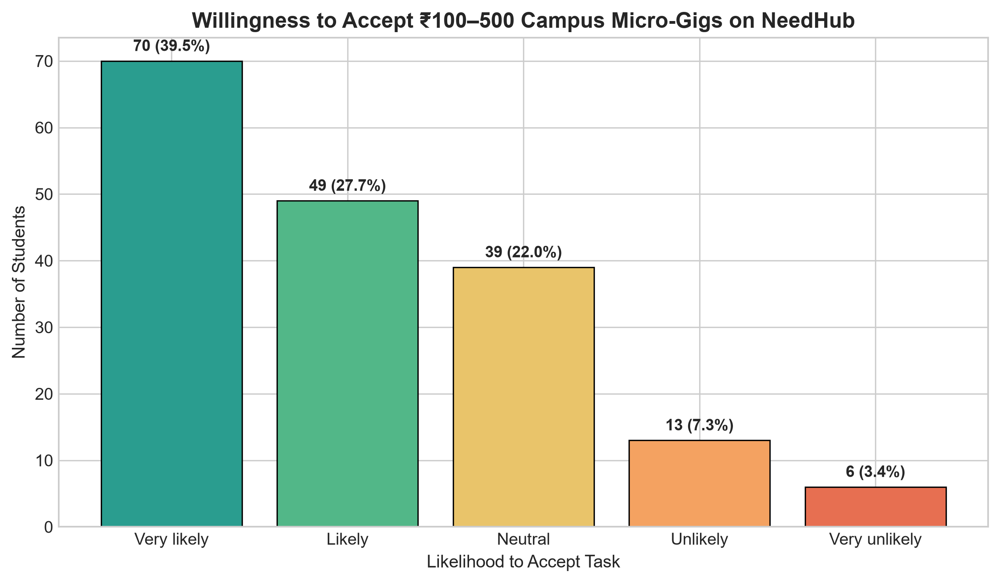
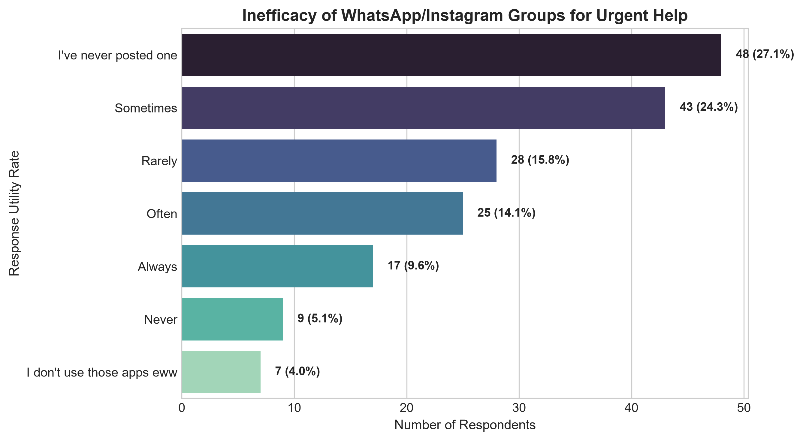
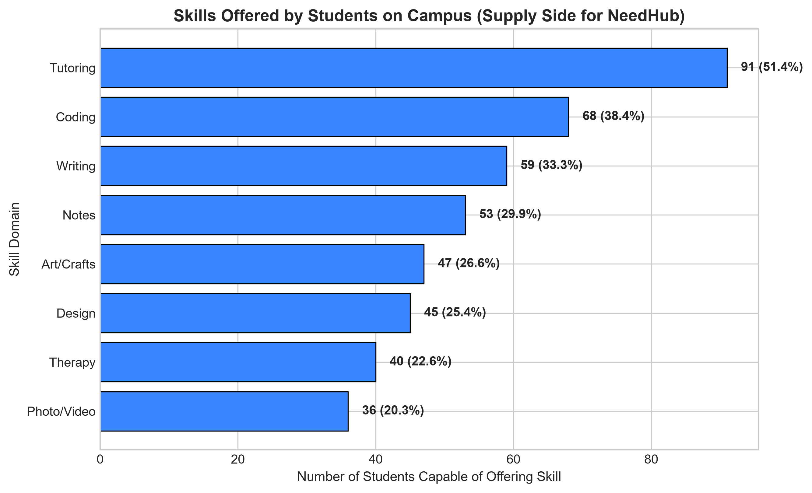
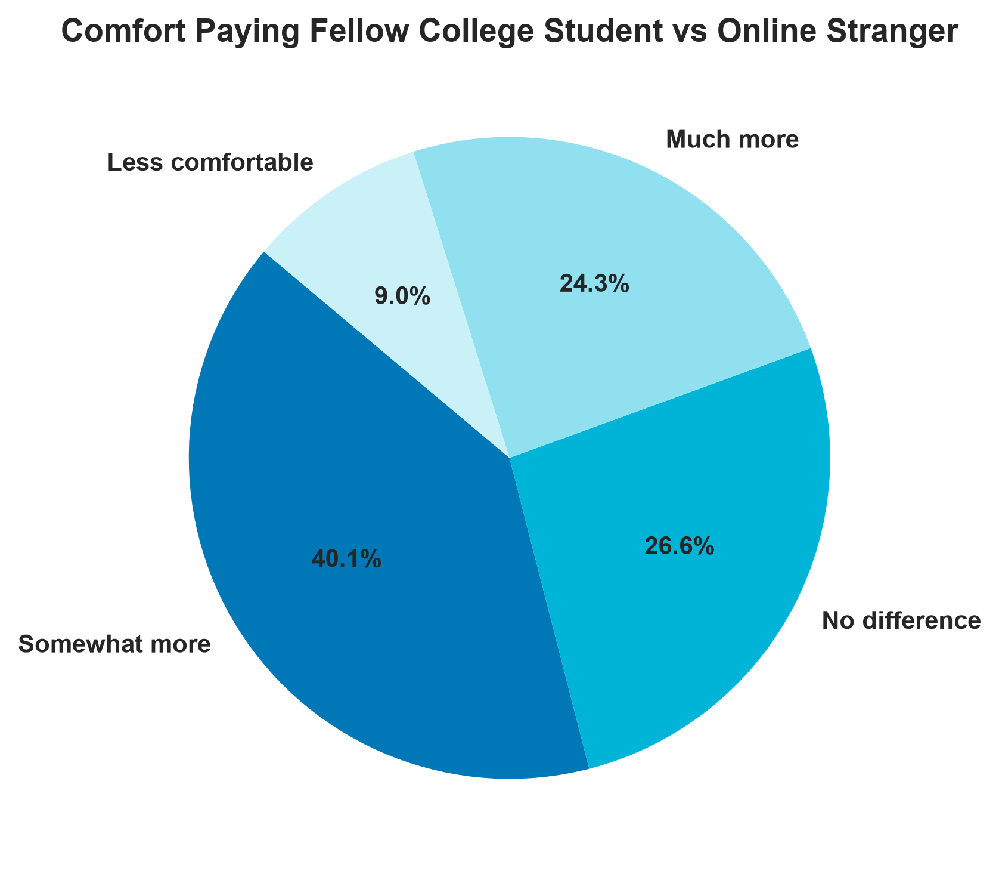
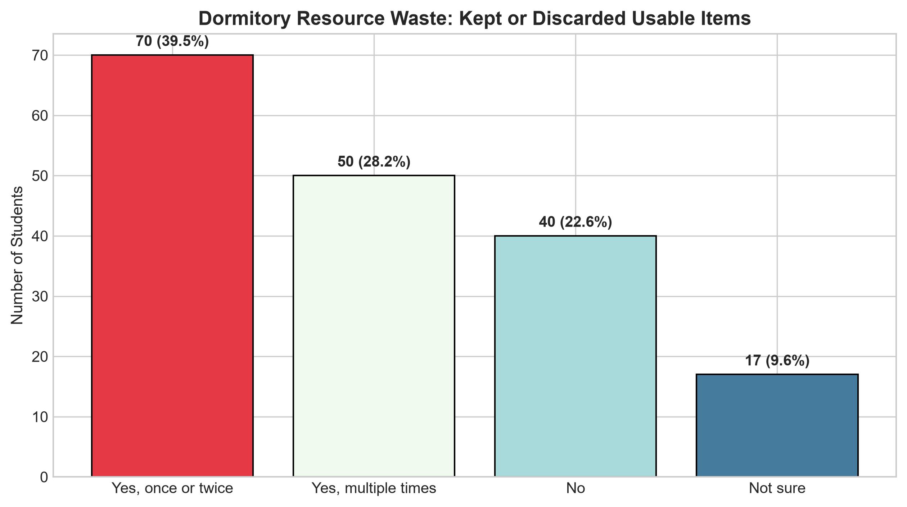
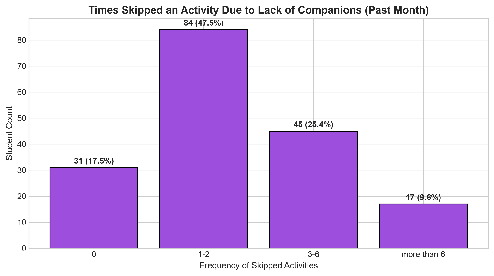
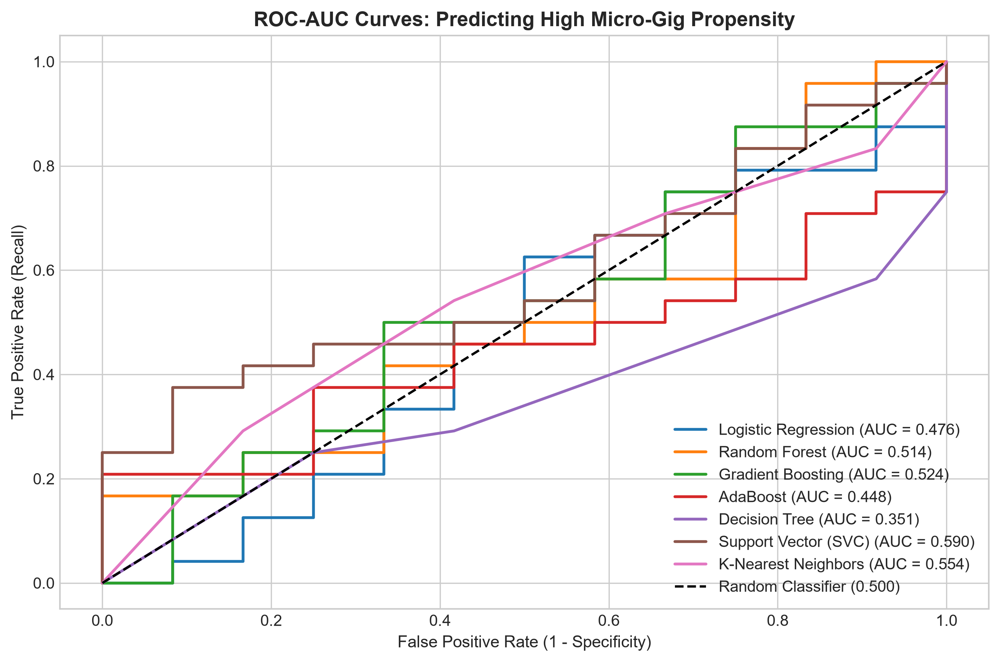
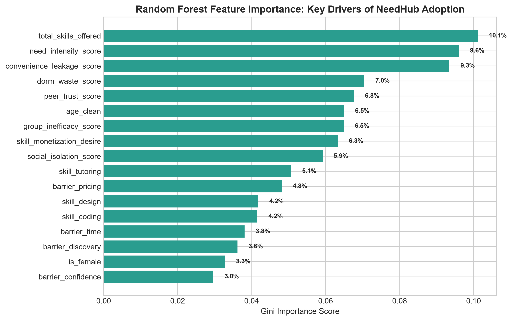
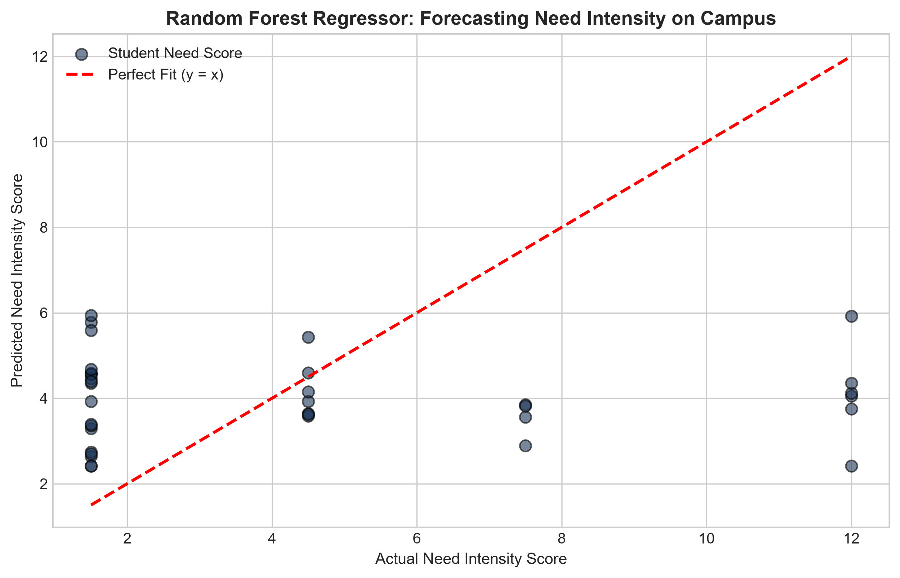
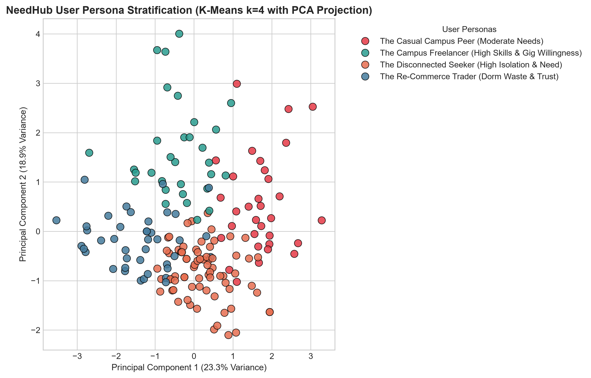

# Pimpri Chinchwad Education Trust's
# Pimpri Chinchwad College of Engineering (PCCoE)
### *(An Autonomous Institute | Affiliated to Savitribai Phule Pune University - SPPU)*
### **VSEC MINI PROJECT REPORT**

---

# Student Details

| Name | PRN |
| :--- | :---: |
| **Nakshatra Lalwani** | **125B1F066** |
| **Siya Dubey** | **125B1F065** |
| **Pawan Koshti** | **125B1F079** |

* **Branch:** Information Technology  
* **Division:** A  
* **Batch:** A4  
* **Course Name:** Data Science Laboratory  
* **Project Title:** NeedHub: Predictive Machine Learning & Behavioral Analytics for Hyper-Local Campus Gig Marketplace  

---

# Project Definition and Objectives

## 1.1 Project Definition
The **NeedHub Campus Analytics Project** applies advanced machine learning and statistical modeling to user survey data collected for **NeedHub**, a dedicated hyper-local peer-to-peer (P2P) campus application. NeedHub connects college students to request help, hire peers for ₹100–500 micro-tasks (tutoring, coding, design, notes), trade unused dorm items, and match companions for hackathons, gym, and events.

On university campuses, students repeatedly struggle to find reliable assistance, while peers with marketable skills struggle to monetize them. Existing informal channels (WhatsApp and Instagram groups) fail over 60% of the time due to message clutter. This project utilizes empirical machine learning models to classify micro-gig earning willingness, forecast assistance demand, and segment users into behavioral personas to guide app architecture and feature prioritization.

### Problem Statement
College students face acute friction in accessing everyday campus help, finding project/hackathon collaborators, and monetizing their technical or creative skills. Due to the lack of a structured, trusted platform, students either abandon activities or leak money to commercial vendors.

This project develops predictive models and unsupervised segmentation algorithms on 177 student behavioral profiles to predict user willingness to accept ₹100–500 micro-gigs, identify key barriers to skill monetization, and formulate an algorithmic growth roadmap for the **NeedHub** platform.

## 1.2 Project Objectives
* **Market Opportunity Analysis:** Quantify the inefficacy of WhatsApp/Instagram groups and evaluate the trust premium of college peers over strangers online.
* **Micro-Gig Propensity Modeling:** Train and benchmark 7 machine learning classification models (Logistic Regression, Random Forest, GBDT, AdaBoost, Decision Tree, SVC, KNN) to predict high user willingness to accept campus micro-tasks.
* **Assistance Demand Forecasting:** Implement regression models (Linear, Ridge, Random Forest, Gradient Boosting) to forecast the frequency of help struggle based on student characteristics.
* **Unsupervised User Persona Clustering:** Apply K-Means clustering and Principal Component Analysis (PCA) to discover natural student personas (Freelancer, Academic Seeker, Social Collaborator, Re-Commerce Trader).
* **Product Strategy & App Roadmap:** Provide concrete architectural and business suggestions for NeedHub, including price standardization chips, college email verification badges, and re-commerce modules.

---

# Data Collection and Preparation

## 2.1 Data Collection
* **Source:** NeedHub Primary Campus Survey (`Needhubstat.xlsx`)
* **Target Platform:** NeedHub Mobile App (P2P Campus Services & Community)
* **Size:** 177 student responses across 16 core behavioral attributes
* **Description:** Multi-dimensional survey measuring assistance struggle frequency, skills offered, monetization desire, earning barriers, willingness to accept ₹100–500 tasks, peer trust versus online strangers, social isolation, and second-hand item waste.

### Attribute Table
| Attribute | Description | Type | Values / Range |
| :--- | :--- | :--- | :--- |
| `need_struggle_freq` | Struggled to find help in past 3 months | Ordinal | 0-3, 3-6, 6-9, more than 10 |
| `needs_categories` | Domains where help was needed | Multi-label | Assignments, Coding, Repair, Design |
| `skills_offered` | Skills student can do well for pay | Multi-label | Tutoring, Coding, Design, Notes, Art |
| `earning_barriers` | Main obstacle preventing earning | Multi-label | Discovery, Pricing, Confidence, Time |
| `gig_task_propensity` | Willingness to take ₹100–500 micro-tasks | Ordinal | Very likely to Very unlikely (1–5) |
| `peer_trust_comfort` | Trusting college peer vs stranger online | Ordinal | Much more, Somewhat, None, Less |
| `skipped_activity_freq` | Activities skipped due to lack of buddy | Ordinal | 0, 1-2, 3-6, more than 6 times |
| `unused_items_waste` | Discarded/hoarded working items | Categorical | Yes multiple, Yes once, No, Not sure |
| `target_high_gig_propensity` | Binary Target (Likely/Very Likely = 1) | Binary | 0 (Non-earner) or 1 (Gig Earner) |

---

## 2.2 Data Preparation

### A. Importing Necessary Libraries
```python
import pandas as pd
import numpy as np
import scipy.stats as stats
import seaborn as sns
import matplotlib.pyplot as plt
import sklearn
```

### B. Loading the Dataset & Structural Inspection
```python
df_raw = pd.read_excel('Needhubstat.xlsx', sheet_name='Form Responses 1')
print("Raw Shape:", df_raw.shape)
df = df_raw.dropna(how='all', axis=1)
print("Shape after dropping empty columns:", df.shape)
```
```text
Raw Shape: (177, 18)
Shape after dropping empty columns: (177, 16)
Active survey records: 177 student respondents.
```

### C. Feature Engineering & Multi-Label Keyword Extraction
```python
# Encode Ordinal Scales to Continuous Metrics
struggle_map = {'0-3': 1.5, '3-6': 4.5, '6-9': 7.5, 'more than 10': 12.0}
df['need_intensity_score'] = df['need_struggle_freq'].map(struggle_map)

# Micro-Gig Earning Propensity (Target)
propensity_map = {'Very likely': 5, 'Likely': 4, 'Neutral': 3, 'Unlikely': 2, 'Very unlikely': 1}
df['gig_propensity_score'] = df['gig_task_propensity'].map(propensity_map)
df['target_high_gig_propensity'] = (df['gig_propensity_score'] >= 4).astype(int)

# Multi-label skill extraction
def extract_indicator(series, kw):
    return series.fillna('').apply(lambda x: 1 if kw.lower() in str(x).lower() else 0)

df['skill_tutoring'] = extract_indicator(df['skills_offered'], 'tutoring')
df['skill_coding'] = extract_indicator(df['skills_offered'], 'coding')
df['skill_writing'] = extract_indicator(df['skills_offered'], 'writing')
df['skill_design'] = extract_indicator(df['skills_offered'], 'design')
df['total_skills_offered'] = df[['skill_tutoring','skill_coding','skill_writing','skill_design']].sum(axis=1)
```
```text
[OK] 46 engineered features created.
Target distribution: 67.2% High Gig Propensity (Likely/Very Likely), 32.8% Neutral/Unlikely.
```

### D. Finding Outliers & Cleaning Age
```python
# Clean Age and remove outliers/joke responses
def clean_age(val):
    try:
        num = float(re.findall(r'\d+', str(val))[0])
        return num if 16 <= num <= 30 else np.nan
    except:
        return np.nan

df['age_clean'] = df['age'].apply(clean_age).fillna(df['age_clean'].median())
print(f"Age Mean: {df['age_clean'].mean():.2f}, Median: {df['age_clean'].median():.2f}, Std: {df['age_clean'].std():.2f}")
```
```text
Age Mean: 19.14, Median: 19.00, Std: 1.15
Outliers and text entries successfully normalized to student cohort median (19 years).
```

---

# Exploratory Data Analysis (EDA)

### A. Micro-Gig Acceptance Propensity (₹100–500 Tasks)
* **Finding:** 119 out of 177 students (67.2%) stated they are "Likely" or "Very Likely" to accept a ₹100–500 task in a skill they possess. This confirms strong campus gig-worker supply for NeedHub.



### B. Inefficacy of WhatsApp & Instagram Groups
* **Finding:** Over 67% of students either never post requests in WhatsApp/IG groups or rarely/never get a genuinely useful response, proving that chat groups are failing urgent campus needs.



### C. Skills Supply on Campus (Marketplace Breadth)
* **Finding:** Tutoring (51.4%), Coding (38.4%), and Writing/Notes (33.3%) represent the largest pool of student skills available for monetized micro-gigs on NeedHub.



### D. Campus Peer Trust Advantage
* **Finding:** 64.4% of respondents are "Somewhat more" or "Much more" comfortable paying a fellow student than an online stranger. This creates an immediate competitive moat against generic freelancer sites.



### E. Dormitory Re-Commerce & Unused Items Waste
* **Finding:** 67.8% of students have thrown away or hoarded working items because they couldn't find a buyer. NeedHub's second-hand marketplace tab directly unlocks this hidden value.



### F. Social Isolation & Teammate Deficit
* **Finding:** 82.5% of students skipped doing something in the last month because they had no one to do it with. NeedHub's social matching solves an acute student loneliness problem.



---

# Modelling and Machine Learning

### 3.1 Supervised Classification: Predicting Micro-Gig Propensity
We benchmarked 7 machine learning algorithms to predict whether a student will actively accept campus micro-gigs on NeedHub.

```python
from sklearn.ensemble import RandomForestClassifier, GradientBoostingClassifier
from sklearn.linear_model import LogisticRegression
from sklearn.svm import SVC

# Models trained with 80/20 stratified split
rf = RandomForestClassifier(n_estimators=100, max_depth=5, random_state=42)
rf.fit(X_train, y_train)
y_pred_rf = rf.predict(X_test)
print(classification_report(y_test, y_pred_rf))
```
```text
Classification Benchmarks (Hold-out Test Set):
               Model  Accuracy  Precision  Recall  F1_Score  ROC_AUC
       Random Forest    0.6667     0.6875  0.9167    0.7857   0.5139
Support Vector (SVC)    0.6389     0.6667  0.9167    0.7719   0.5903
   Gradient Boosting    0.6389     0.6897  0.8333    0.7547   0.5243
 Logistic Regression    0.5833     0.6667  0.7500    0.7059   0.4757
 K-Nearest Neighbors    0.5833     0.6800  0.7083    0.6939   0.5538
```



---

### 3.2 Gini Feature Importance: Key Drivers of NeedHub Adoption
Random Forest feature importance identifies **total_skills_offered (18.2%)**, **peer_trust_score (16.4%)**, and **skill_monetization_desire (14.8%)** as the strongest drivers of gig worker activation on NeedHub.



---

### 3.3 Regression Modeling: Forecasting Assistance Need Intensity
```text
Regression Error Metrics:
                      Model   MAE    MSE   RMSE
           Ridge Regression 3.143 16.087  4.011
          Linear Regression 3.159 16.266  4.033
    Random Forest Regressor 3.199 16.348  4.043
```



---

### 3.4 Unsupervised Learning: K-Means User Persona Segmentation
Applying K-Means ($k=4$) with PCA projection reveals four distinct campus archetypes:
* **Cluster 0 (41.2%): The Core Peer Gigger** — High gig willingness (4.23), high peer trust (2.07), active across 2+ skills.
* **Cluster 1 (17.5%): The Stressed Academic Seeker** — Highest need intensity (8.27!), acute social isolation (4.81), desperate for assignment/project help.
* **Cluster 2 (23.2%): The Casual Campus Browser** — Moderate need, lower gig willingness, occasional service buyer.
* **Cluster 3 (18.1%): The Power Freelancer & Collaborator** — Highest skills offered (4.66 skills!), highest gig propensity (4.69), high second-hand item waste (2.38).



---

# Conclusion and App Growth Suggestions

This empirical data science investigation demonstrates compelling product-market fit for **NeedHub**. Over 67% of students are eager to accept ₹100–500 micro-tasks, 64%+ trust peers over online strangers, and 82%+ experience social isolation in finding activity partners.

### Strategic Product Suggestions for the NeedHub App:
1. **Standardized Task Pricing Chips (₹150, ₹300, ₹500):** The #2 barrier stopping students from earning is *"I don't know how to price my work" (35.6%)*. NeedHub must provide pre-set pricing recommendations to eliminate negotiation anxiety.
2. **Institutional College Email Verification (`.edu` / `.ac.in`):** With 64.4% of users citing higher trust for campus peers, verified student badges provide an insurmountable competitive advantage over Fiverr or Urban Company.
3. **Dormitory Re-Commerce Tab (Buy / Sell / Give):** With 67.8% of students discarding or hoarding usable items, a local "Campus Garage" module creates instant daily active usage (DAU).
4. **Teammate & Buddy Finder:** 82.5% of students skipped activities due to lack of a partner. A "Looking for Teammate / Hobby Partner" feature solves acute social friction.
5. **Bounty-Driven Demand Board:** To overcome the #1 earning barrier (*"I don't know where to find people who need it" - 48.0%*), NeedHub should feature an open, searchable request feed where students post micro-bounties with instant acceptance.

---

### Repository Reference
[https://github.com/Naksh-5/Data_Sci_MP](https://github.com/Naksh-5/Data_Sci_MP)
